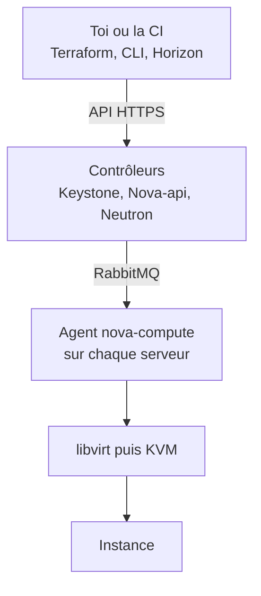
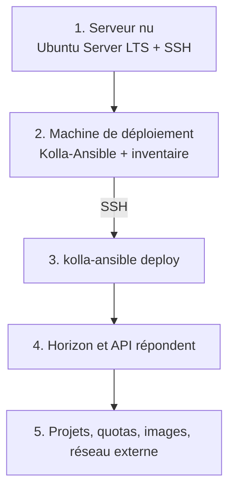

# OpenStack

Une couche libre-service au-dessus d'hyperviseurs. On lui donne des serveurs,
il rend une API et un site web où chacun crée ses VMs tout seul. C'est ce qui
fait tourner OVHcloud et Infomaniak.

- [[OpenStack Lab DevStack]] monter un lab d'apprentissage
- [[OpenStack Commandes]] utiliser au quotidien
- [[OpenStack Bonnes pratiques]] les règles en entreprise

## Réponses rapides

**Différence avec Proxmox ?** Proxmox crée des VMs, l'admin pilote. OpenStack
ajoute l'API, les projets isolés, les quotas, le placement automatique. En
dessous, c'est le même KVM.

**Je remplace mon Proxmox ?** Non. Sous 10 serveurs, Proxmox gagne.

**Et Kubernetes ?** Pas concurrent. OpenStack gère des VMs, K8s des
conteneurs.

**Vocabulaire.** Une VM est une *instance*. Un gabarit est une *flavor*. Un
espace isolé est un *projet*.

**On installe quoi sur le serveur nu ?** Ubuntu Server LTS et SSH, rien
d'autre. Le reste est poussé par Kolla-Ansible en SSH.

**Comment il connaît les serveurs ?** Un agent `nova-compute` tourne sur
chacun, se connecte à RabbitMQ et s'annonce avec ses ressources libres.

## Les briques

| Nom | Rôle |
|---|---|
| Keystone | Identité, tout passe par lui en premier |
| Nova | Crée les instances, pilote KVM |
| Neutron | Réseaux, routeurs, IP flottantes, pare-feu |
| Glance | Catalogue des images système |
| Cinder | Disques attachables |
| Swift | Stockage objet, équivalent S3 |
| Horizon | Interface web |
| Heat | Déploie une pile depuis un YAML |

## La chaîne

| Outil | Rôle |
|---|---|
| OpenStack | Fabrique les VMs, réseaux, disques |
| Terraform | Décrit ce qu'il faut fabriquer |
| Ansible | Configure ce qui a été fabriqué |

Sans OpenStack, Terraform n'a aucune API à appeler sur du matériel à soi.

## Jour 1, monter la plateforme

Seule l'étape 1 est manuelle. **DevStack ne sert qu'aux labs**, jamais en
production.

## Quand ce n'est pas le bon outil

Moins de 10 serveurs ou pas d'équipe dédiée : Proxmox.
Bases de données managées : cloud public.
Conteneurs plutôt que VMs : Kubernetes.

OpenStack se justifie quand les trois sont réunis : volumétrie, souveraineté,
et des gens pour l'exploiter.

## Doc

https://docs.openstack.org/devstack/latest/
